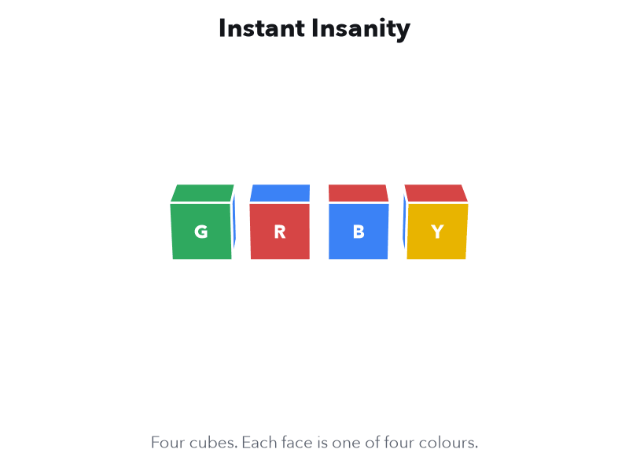

# Instant Insanity on a Quantum Computer

The qBraid challenge at **Qiskit Fall Fest Connecticut 2026**, hosted by UConn Quantum Computing at the University of Connecticut, Storrs. Hacking runs on Saturday, October 17, 2026.

Event page: [account.qbraid.com/hackathons/2026/uconn-fallfest](https://account.qbraid.com/hackathons/2026/uconn-fallfest)

<picture>
  <source media="(prefers-color-scheme: dark)" srcset="assets/instant-insanity-dark.gif">
  
</picture>

## The puzzle

You get four cubes. Each face is painted one of four colours. Stack the cubes into a tower so that every colour shows exactly once on each of the four sides: front, back, left and right.

There are 331,776 ways to stack the four cubes. Only 8 of them work, and those 8 are one tower seen from different angles. People have sold this puzzle as *Instant Insanity* since the 1960s, because it is so hard to solve by hand.

Get a feel for it before you code. IonQ built two interactive pages for the original challenge:

- [Instant Insanity, interactive](https://instantinsanity.z20.web.core.windows.net/): turn the cubes and stack them yourself.
- [The cubes as a network of switches](https://instantinsanity.z20.web.core.windows.net/switches.html): a 5-qubit-per-cube encoding of the cube rotations.

Those pages may paint their cubes differently from the four in this repository. The rules are the same.

The puzzle is a **constraint problem**: many choices, a few rules, and very few choices that obey every rule. Scheduling, routing and chip layout problems have the same shape. Quantum optimization algorithms such as QAOA attack them by turning the rules into an energy and searching for the lowest energy state.

## The challenge

Solve the puzzle with a quantum algorithm, run it through qBraid, and explain what you learned.

| Level | Task |
|---|---|
| **Warm-up** | Work through `starter_notebook.ipynb`. It solves half the puzzle (the front and back of the tower) with QAOA on 12 qubits, and runs the circuit on the AWS SV1 simulator. |
| **Core** | Find a full solved tower for the four cubes in `starter_notebook.ipynb` with a quantum algorithm. Run it on SV1 through qBraid. Report how often your circuit returns a correct tower, what it costs in qubits, gates and credits, and how it compares with classical brute force and random guessing. |
| **Bonus** | Generalize to **N cubes and N colours**. Each cube's faces use N colours, and each colour must show exactly once on each of the four sides. Run your method for as many values of N as you can, and show how qubits, circuit depth and success rate grow with N. |

The general N-cube question is NP-complete (Robertson and Munro, 1978): no one knows a method that stays fast as N grows. N will be small on today's simulators. What we want to see is whether your idea **generalizes**, and how its cost grows.

Teams have 2 to 4 people, and every level is welcome. A team that finishes the warm-up and one clear extension, with honest classical checks, can score well. See [GRADING.md](GRADING.md).

### What this challenge is for

- Getting started in **quantum optimization**: cost functions, Hamiltonians, QAOA and its relatives.
- Building intuition for **when and why** a quantum approach helps, and when it does not.
- Using the **qBraid platform**: qBraid Lab, the qBraid SDK and cloud simulators.
- Using **AI coding agents** for quantum work, with the checks that keep them honest. See [AGENTS.md](AGENTS.md).

## What is in this repository

```
uconn-fall-fest-2026-challenge/
├── README.md                              this file
├── GRADING.md                             deliverables, submission layout and the judging rubric
├── AGENTS.md                              instructions for AI coding agents working on a solution
├── starter_notebook.ipynb                 the puzzle, the classical baseline, the cost Hamiltonian, and a QAOA warm-up on SV1
├── requirements.txt                       Python packages for running locally
├── LICENSE                                Apache-2.0
├── assets/
│   ├── instant-insanity-light.gif         the animation above, light theme
│   └── instant-insanity-dark.gif          the animation above, dark theme
└── resources/
    ├── 01_qiskit_refresher.ipynb          circuits, measurement, parameters, Pauli operators, transpiling
    ├── 02_qbraid_sdk.ipynb                qBraid providers, devices, jobs, the transpiler, cost discipline
    └── 03_qaoa_maxcut_with_qbraid.ipynb   QAOA for a graph problem, end to end, submitted to SV1
```

New to quantum computing? Do the resources in order before the starter notebook. Each one takes about 35 to 40 minutes. Already know Qiskit? Start with the starter notebook. It takes about an hour.

## Getting started

### On qBraid (recommended)

1. Create a free account at [account.qbraid.com](https://account.qbraid.com) with the email you registered with.
2. Open **Explore** in the left sidebar and switch to the **Events & Hackathons** tab.
3. Select **Qiskit Fall Fest Connecticut 2026** in the event list (or **View Details** on its map pin) to open the hackathon page, then go to **Challenges**.
4. On the Instant Insanity challenge card, click **Launch on qBraid**. qBraid Lab opens and clones this repository.
5. Open `starter_notebook.ipynb` and run the cells from the top. The first cell installs anything missing.

Inside qBraid Lab your credentials load automatically, so the SV1 cells submit real jobs with no setup. Follow your jobs on the [quantum jobs page](https://account.qbraid.com/quantum-jobs).

### On your own machine

```bash
git clone https://github.com/qBraid/uconn-fall-fest-2026-challenge.git
cd uconn-fall-fest-2026-challenge
python -m venv .venv && source .venv/bin/activate
pip install -r requirements.txt
jupyter lab
```

To submit to SV1 from your own machine, create an API key in your qBraid account, then run `qbraid configure` or set `QBRAID_API_KEY` in your shell. Never paste a key into a notebook cell. Without credentials, every SV1 cell runs on the local Aer simulator instead and says so.

### Compute and credits

- An SV1 job of the size in these notebooks costs **0.375 qBraid credits**. SV1 bills by simulation time at 7.5 credits per minute, so very deep or very wide circuits cost more.
- SV1 simulates up to 34 qubits. The full one-hot encoding of the four-cube puzzle needs 24 qubits, which SV1 handles easily. A laptop simulator slows down at that size, which is one reason to look for a smaller encoding.
- Debug on the local Aer simulator first. Send a circuit to SV1 once it works.
**Getting credits.** The organizers give each team a qBraid promo code at kickoff. To redeem it, open **Account → Wallet** in [account.qbraid.com](https://account.qbraid.com/account/wallet), choose a credit amount, enter the code in the **Promo code** field, and complete the purchase.

**Earning time on real quantum hardware.** Teams that submit working jobs to SV1 through qBraid can earn extra credits to try their circuits on real quantum devices. Show a qBraid mentor the job IDs of your successful SV1 runs to claim them. Hardware runs are optional. Real devices add noise, so expect a lower success rate than on SV1, and report both.

- A QPU job costs far more than an SV1 job. Check the price on the device page before you submit, and keep shots low.
- Transpile for the device and keep circuits shallow. Deep QAOA circuits lose most of their signal to noise.

## Submitting

Each team submits the link to a **public GitHub repository** that holds its slides, working code and a one-page `SUBMISSION.md` with the IDs of its qBraid jobs. [GRADING.md](GRADING.md) gives the repository layout, every deliverable and the rubric.

## Credits

- The idea of solving Instant Insanity on a quantum computer comes from the IonQ challenge at SC Quantathon v2 (October 2025): [ionq-samples/SCQuantathon-v2](https://github.com/ionq-samples/SCQuantathon-v2). Thank you to IonQ for the original challenge and for the [interactive puzzle](https://instantinsanity.z20.web.core.windows.net/) and [switch-network](https://instantinsanity.z20.web.core.windows.net/switches.html) visualizations linked above. This repository contains new material written for Qiskit Fall Fest Connecticut 2026 and copies no code from that repository.
- The graph method in the starter notebook is the classic solution described in the [Wikipedia article on Instant Insanity](https://en.wikipedia.org/wiki/Instant_Insanity).
- E. Robertson and I. Munro, "NP-completeness, puzzles and games", *Utilitas Mathematica* 13 (1978) 99-116.

Challenge by [qBraid](https://www.qbraid.com) for Qiskit Fall Fest Connecticut 2026, hosted by UConn Quantum Computing, with IBM Quantum, QuantumCT and the UConn School of Computing.

## License

Apache-2.0. See [LICENSE](LICENSE).
