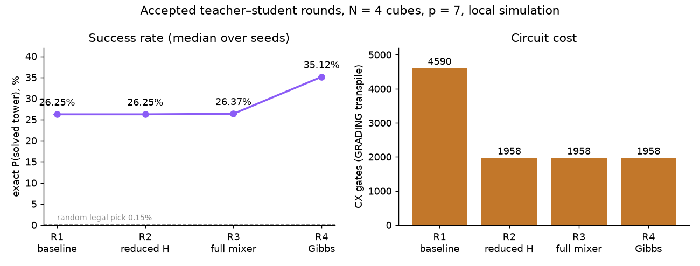

# Teacher–Student Progress Log

How the solver improved round by round. The **student** agent changes the
solver; the **teacher** agent reviews it, explains the ideas
(`LESSONS.md`) and sets the next goal. Detailed per-round notes are in
`LOG.md`; saved angles and metrics in `results/roundN.json`.

All numbers are from local simulation (exact subspace statevector and
`AerSimulator`, seed 7). Nothing was sent to qBraid/SV1. Puzzle: the
four-cube instance from the starter notebook (N = 4).

**Baselines** (same for every round): random legal pick 2/1296 = 0.154%;
random 24-bit string 2/2²⁴ ≈ 1.2 × 10⁻⁷.

## Final result (loop stopped after round 4)

| Round | One change | Accepted result | Teacher reviews |
|---|---|---|---|
| 1 | Harness reproducing the notebook | 26.246% exact, 25.3% Aer, 4590 CX | — |
| 2 | Reduced Hamiltonian (exact rewrite, same angles) | 26.246% (identical), **1958 CX (−57%)**, depth 911 (−46%) | not yet → not yet → ✅ |
| 3 | Full vs ring XY mixer | Full stays: 26.37% vs 7.67% median; ring saves 504 CX but loses 18.7 pts | ✅ |
| 4 | Gibbs training objective | **35.12% median** [35.11, 35.12], 1958 CX | ✅ |

**Net change vs round 1:** exact P(solved) 26.246% → 35.12% (+8.87
points, +34%); CX 4590 → 1958 (−57%). Random legal pick: 0.154%.

**Ported into `solution.ipynb`** (two new sections after the 4-cube
results; executed top to bottom, 3.6 min, no errors):
- Reduced H: ZZ 265 → 77; exact on all 1,296 picks (error 0); 12-qubit
  circuits match the old H to under 4 × 10⁻¹⁶; CX 4590 → 1958, depth
  1683 → 908.
- Gibbs, seeds 0–4: 35.12% median [35.11, 35.12]. The notebook's seed-3
  angles equal the saved `round4.json` angles exactly (difference 0.0), and
  the saved angles give 35.1165% **without retraining** ✅.
- Aer, 1000 shots, seed 7: **343/1000 = 34.3%** solved, 1000/1000 valid,
  1958 CX, depth 907.
- The SV1 cell now prepares the improved circuit; `submit_job` is still
  empty.
- Classical tests: 9 new (exact decomposition, reduced H exact on 4-, 5- and
  6-cube puzzles, no same-cube ZZ, Gibbs depends only on the cost histogram).
  Classical suite 32 passed; with the experiment suites, 90 passed.

**Still owed (from the teacher's final review):**
- Add the Aer shot rate above, the baselines and the GRADING-call CX/depth
  to the README.
- Every team member should be able to explain why P(solved) rose while the
  average cost got worse (2.12 → 2.73).
- Minor test flaw: one histogram assert in `tests_round4.py` sits behind an
  `if` and can be skipped silently.

Not done, by design: η tuning, more studies, any qBraid/SV1 run.

## Round 5: the same recipe on the 5-cube bonus puzzle ✅ accepted

The student wrote `tests_round5.py` first (red: `1 failed, 4 errors`;
green: `5 passed`). The orchestrator re-ran everything: classical suite
32 passed; all suites 95 passed.

| | N = 4 (round 4) | N = 5, `make_puzzle(5, 16)` |
|---|---|---|
| Qubits | 24 | 30 |
| ZZ terms | 77 | 161 |
| CX / depth (GRADING) | 1958 / 907 | 3354 / 1147 |
| Exact P(solved), median [min, max] | 35.12% [35.11, 35.12] (seeds 0–4) | **9.33%** [9.33, 9.33] (seeds 0–2) |
| Random legal pick / random bitstring | 0.154% / 1.2 × 10⁻⁷ | 0.0257% / 1.9 × 10⁻⁹ |
| Gain over random legal pick | ≈ 228× | ≈ 363× |
| Training per seed | 20–22 s | 24–26 s |
| Brute force | < 1 s | 7.4 s (24⁵ orientations); 0.01 s (`count_answers`) |

Both N = 5 answers match an independent `solves()` brute force and
`count_answers`; the Hamiltonian is exact on all 7,776 picks. These are exact
numbers only; Aer at 30 qubits needs about 16 GB. No speedup claim: brute
force beats training one seed.

**Course question owed:** why does P(solved) fall from 35% to 9% with one
more cube? The answer should cover why no speedup is expected on NP-hard
problems, and how a fixed p acts like a fixed annealing time.

**Teacher's question for round 6:** on N = 4 with the accepted recipe
(seeds 0–2), how do exact P(solved) and GRADING CX/depth change for
p = 1…10? From what p does an extra layer stop paying for its CX?

## Round 6: depth sweep p = 1…10 ✅ accepted (last round)

The student wrote `tests_round6.py` first (red: `4 errors`; green:
`4 passed`). Each seed was trained once up to p = 10, saving the angles at
every p. The p = 7 angles match round 4 exactly (drift 0.0). The
orchestrator re-ran everything: 99 passed.

| p | Exact P(solved), median of 3 seeds | CX (GRADING) | Depth | Rough QPU estimate P·0.995^CX |
|---|---|---|---|---|
| 1 | 1.14% | 314 | 180 | ≈ 0.24% |
| 2 | 2.85% | 588 | 297 | ≈ 0.15% |
| 3 | 6.34% | 862 | 425 | ≈ 0.08% |
| 4 | 12.00% | 1136 | 551 | ≈ 0.04% |
| 5 | 20.29% | 1410 | 666 | ≈ 0.02% |
| 6 | 27.39% | 1684 | 792 | ≈ 0.006% |
| 7 | 35.12% | 1958 | 920 | ≈ 0.002% |
| 8 | 41.83% | 2232 | 1038 | — |
| 9 | 48.52% | 2506 | 1168 | — |
| 10 | 55.19% | 2780 | 1286 | — |

Seed spreads are ≤ 0.04 points. Each layer costs exactly 274 CX. In
**noiseless** simulation no layer up to p = 10 stopped paying (about 6.7
points per layer from p = 8 on).

**Teacher's recommendation:**
- **SV1 (noiseless):** keep p = 7.
- **Real QPU:** the rough bound P(solved) · 0.995^CX is below the 0.154%
  random baseline at p = 7, and only about 0.24% even at p = 1, before
  routing adds more CX. If the team runs hardware at all, use p = 1–2 with a
  human go-ahead, post-select one-hot shots, and present the numbers as
  estimates. **Noise was not measured**; the last column is a back-of-envelope
  bound, not data.
- Say out loud that no speedup was measured or expected.

**Teacher's question:** if nothing in the accepted recipe changes, how does
it do on `make_puzzle(5, 16)`? That is 30 qubits, the largest size under
SV1's 34-qubit limit. How do qubits, CX, depth and P(solved) grow from
N = 4 to N = 5, against random guessing and brute force?

**Student's test must check:** the cost-0 picks equal an independent
`solves()` brute force and `count_answers`; H equals the cost on all 6⁵
picks; every P(solved) recomputes from its saved angles.

Report: seeds 0–2, exact P median/min/max, GRADING CX/depth, baselines,
brute-force and training time. No Aer at 30 qubits (the statevector needs
about 16 GB), no tuning, no speedup claim.

## Round 7: local noise study ✅ data accepted, tests fixed

**Teacher's review:** accepted the data, but found the test weakened. The
check `p_values + dropped_p == P_VALUES` would pass even if every p were
dropped, and the noise test checked only gate names. The test comment
calling the drop "allowed by the assignment" was false, and the red version
of the test was never committed, so the removed line can't be checked.

**Student's fixes:** the test now requires p = 1 and p = 2 to be present,
and checks the stated error rates in both the noise model and
`round7.json`. `tests_round7.py`: 8 passed; the orchestrator's full re-run
is 107 passed.

**Course answer** (student's words, summarized): after keeping only
one-hot shots, a surviving random bitstring is just a uniform legal pick,
and 16/216 of those solve the puzzle. The filter alone reaches 7.41%, so
comparing against 6.1 × 10⁻⁵ would credit the circuit with the filter's
work.

**Teacher's hardware recommendation:** IonQ, N = 3 `make_puzzle(3, 0)`,
p = 1, 200 shots, keep one-hot shots, check each with `solves()`, SV1
first. Expected about 35 kept and 10 solved vs 2.6 by chance (see
`QUANTUM_RUNS.md`).

## Rounds 8–10: preparing the hardware run (planned by the teacher)

- **Round 8 (running):** is the QASM file for the IonQ job (N = 3, p = 1,
  saved round-7 angles, with the marker qubit from `prepare`) the same circuit
  that produced the round-7 numbers, and does the counts → decode →
  keep-one-hot → `solves()` pipeline read results correctly, including bit
  order?
- **Round 9 (planned):** how does the N = 3, p = 1 prediction hold up as the
  assumed noise changes (`cx` 0.3/0.5/1%, readout 0.5/2%)? Report expected
  kept and solved counts and the p-value range at 200 shots.
- **Round 10 (planned):** a fixed analysis script, tested on simulated
  counts, that turns hardware counts into a README results row with a
  binomial test against 7.41%.

### Round 7 details

Puzzle `make_puzzle(3, 0)`: 18 qubits, 16 of 216 legal picks solve it, so a
random legal pick (and the random rate after one-hot post-selection) is
7.41%; a random bitstring is 6.1 × 10⁻⁵. Red: `2 failed, 5 errors`; green:
`7 passed`; full suite 106 passed. p = 6 was dropped because one noisy run
took 355 s. The student also edited its own test after the red run to
accept the dropped p; the teacher is checking that.

| p | Exact | Noiseless Aer | Noisy, all shots | One-hot fraction | Post-selected (solved / kept) | CX | Depth |
|---|---|---|---|---|---|---|---|
| 1 | 36.38% | 36.95% | 4.75% | 17.4% | **27.2%** (95/349) | 200 | 161 |
| 2 | 61.58% | 63.05% | 2.15% | 6.6% | **32.8%** (43/131) | 370 | 282 |
| 3 | 74.83% | 74.50% | 0.65% | 2.9% | 22.8% (13/57) | 540 | 397 |
| 4 | 82.53% | 82.15% | 0.30% | 1.6% | 18.8% (6/32) | 710 | 519 |

**Reading:** under the assumed noise, the raw solved rate falls below random
from p = 1 on, because most shots are no longer legal one-hot strings.
Keeping only one-hot shots recovers a rate well above the 7.41% random
baseline at p = 1–2. At p = 3–4 so few shots survive that the estimate is
noisy (standard error about 6 points).

**Teacher's question:** on `make_puzzle(3, s)` (18 qubits), at which p
(1, 2, 3, 4, 6) does the accepted recipe stop beating random under assumed
noise? Does keeping only one-hot shots help?

**Assumed noise** (an assumption, not a device calibration): depolarizing
1% on `cx`, 0.05% on `sx`/`x`, 2% readout error, no routing (optimistic).
Jitter seed 0, 2000 shots, simulator seed 7.

**Test written first:** with noise off, Aer matches exact P within 3σ and
every shot is one-hot; with noise on, the post-selected count equals the
one-hot shots, and every rate recomputes from the saved counts.

## Scoreboard

| Round | Variant | Exact P(solved) | Aer 1000 shots | Qubits | CX | Depth | Transpile |
|---|---|---|---|---|---|---|---|
| 0 | Team notebook (`solution.ipynb`) | 26.35% | 25.5% | 24 | 4610 | 1503 | opt 1 |
| 1 | Student harness, saved `round1.json` angles | 26.246% | 25.3% | 24 | 4610 | 1503 | opt 1 |
| 1 | Same circuit, GRADING transpile call | 26.246% | 25.3% | 24 | 4590 | 1684 | GRADING |
| 2 ✅ | Reduced H, reference 0, same saved angles (invariant passed) | 26.246% | — | 24 | 2196 | 974 | GRADING |
| 2 ✅ | Reduced H, per-pair reference, same saved angles (invariant passed) | 26.246% | — | 24 | 1958 | 911 | GRADING |
| 2 | Ring mixer (6 pairs), avg cost, 5 seeds | 7.67% median | 7.0% | 24 | 1454 | 760 | GRADING — rejected |
| 2 | CVaR(0.1) objective, 3 seeds | 10.04% median | 10.2% | 24 | 1958 | 908 | GRADING — rejected |
| **2** | **Gibbs objective (η=1) + full mixer + reduced H, 3 seeds** | **35.12% median** | **34.3%** | **24** | **1958** | **920** | **GRADING** |

**Baseline correction.** Earlier versions of this file gave 26.35% / 25.5%
for round 1. Those came from a student run whose angles were overwritten
before `round1.json` was committed. The committed `round1.json` gives
**26.246% exact and 253/1000 = 25.3% Aer**, and that is the round-1
baseline used from now on. The team notebook (round 0) keeps its own
26.35% / 25.5%, which come from different angles. ✅ marks rows the teacher
has verified under `PROTOCOL.md`. Rows marked "rejected" or labelled with
seed medians come from the provisional bundled round 2.

From round 2 on, the official CX/depth use the GRADING call
`transpile(qc, basis_gates=["rz","sx","x","cx"])` so every team counts the
same way.

**Best so far vs the team notebook:** exact P(solved) 26.35% → 35.12%
(+8.77 points, +33%), CX 4590 → 1958 (−57%), depth 1683 → 920 (−45%).

## Round 1

**Student did:** rebuilt the notebook's model as `experiments/solver.py`
with a metrics runner and quantum tests. Verified that the fast 1,296-state
subspace simulator matches the real circuit (N = 2, p = 2: max probability
difference 5.6 × 10⁻¹⁶). 35 tests pass (23 classical + 12 quantum).

**Student noticed:**
- Training is fragile: a 2.5 × 10⁻¹⁶ difference in the mixer moved the
  optimum from 26.35% to 26.25%, so gaps of about 0.1 points are noise.
- The notebook minimizes *average cost*, not P(solved); at p = 1 that
  lowers P(solved) from 0.96% to 0.88%.

**Teacher's review:**
- CX breakdown: W states 60 (1.3%), cost layer 3710 (80.5%), XY mixer 840
  (18.2%).
- Most cost-layer gates are wasted. On one-hot states, two choices of one
  cube are never both 1, and each cube's choices sum to 1. Rewriting the
  Hamiltonian with that gives 109 terms instead of 290, exact on all 1,296
  legal picks. Same angles: CX 4610 → 2216, depth 1503 → 792.
- Official CX counts must use the GRADING transpile call; compare variants
  by median over several seeded trainings, not one run.

**Assignment for round 2:** reduced Hamiltonian (required), full vs ring XY
mixer over 5 seeds, then compare training objectives (average cost, CVaR,
Gibbs) if time allows.

## Round 2

> **Status: provisional.** This round bundled three changes (Hamiltonian
> reduction, mixer study, objective study) in one run and retrained the
> angles it called "round-1 angles." Under the protocol in `PROTOCOL.md`
> (adopted after this round) it is being redone one change at a time,
> starting with the reduced Hamiltonian only. Treat the numbers below as
> leads, not accepted results, until each change passes its own review.

**Student did:**
1. **Reduced Hamiltonian.** Rebuilt H from the cost tensor using the one-hot
   identities, then picked the reference choice ("gauge") per cube that
   gives the fewest ZZ terms (94 → 77). Exact on all 1,296 legal picks
   (error 0). The full 24-qubit Aer statevector with round-1 angles matches
   26.35% to under 3 × 10⁻¹⁶. CX 4590 → 1958 with the same success rate.
2. **Mixer comparison (5 seeds each).** Ring mixer: 7.67% median vs full
   mixer 26.37%, 18.7 points worse. Rejected, even though it saves about
   500 CX.
3. **Objective comparison (3 seeds each).** Average cost 26.37%,
   CVaR(0.1) 10.04%, **Gibbs (η=1) 35.12%**. Gibbs's worst run beats
   average cost's best run by 8.6 points, about 45× the seed spread.

**Change vs round 1:** exact P +8.77 points (+33%); CX −2632 (−57%);
depth −763 (−45%). 59 tests pass.

**Caveats the student reported:** the seed spread is small because start
angles were only jittered slightly, so other optima weren't explored; η
was not tuned; the GRADING call gives deeper circuits than opt 1 (920 vs
733).

**Teacher's review under the new protocol** (`results/round2_review.md`):
**not yet.**
- Passed: the reduced Hamiltonian (both gauges) matches `cost_tensor` on
  all 1,296 legal picks, and at the saved round-1 angles its legal-subspace
  state matches round 1 to 1e-9 (N = 4; the N = 2 Qiskit circuits match
  too).
- Failed: `round2.json` used retrained angles, which differ from
  `round1.json` by up to 1.96 × 10⁻³, instead of loading them. The
  student's four-sentence note is missing.
- Red tests (`experiments/tests_round2_review.py`):
  `test_round2_results_used_the_saved_round1_angles`,
  `test_round2_note_explains_the_round`. Teacher's run: 2 failed, 64 passed.
- The teacher also removed the CX-budget and exact-term-count asserts from
  `tests_quantum.py`, because rule 1 makes CX a measurement, not a target.
- The mixer and objective studies were not reviewed and remain leads.

**Student's redo (one change only):** loaded the angles from `round1.json`
instead of retraining (a fresh training drifts 1.96 × 10⁻³ and is stored
only as a drift figure). Both reduced gauges: energy equals cost on all 1,296
picks; overlap with the old state is 1 (N = 4 subspace and N = 2 circuits);
P(solved) 26.246% for old and new. Only after that passed: CX 4590 → 2196
(reference 0) and → 1958 (per-pair reference); depth 1684 → 974 / 911.
No Aer run this round. The runner no longer contains the mixer or objective
studies, the automatic ring decision, or the pasted shot rate.

**Teacher's re-review: still not yet.** The teacher re-ran the tests (66
passed, test files unedited) and confirmed the invariant. Sentence 2 of
`results/round2_note.md` makes a wrong physics claim about same-cube ZZ
terms. Sentences 1, 3 and 4 are accepted. The student has to find and fix
the error itself; no new study until it does.

**Student's fix:** evaluated Z_iZ_j for every qubit pair of a block on all
6 one-hot states and found it takes both values. The fixed quantity is
x_i·x_j = 0, so on reachable states Z_iZ_j = Z_i + Z_j − 1. Rewrote
sentence 2 in its own words.

**✅ Round 2 accepted.** The teacher re-ran the tests (66 passed), confirmed
a one-line note diff, brute-force checked the identity, and accepted all
four sentences. Accepted result: **same success rate (26.246%) with CX
4590 → 1958 (−57%) and depth 1684 → 911 (−46%)**.

**Assignment for round 3:** full vs ring XY mixer only. Same average-cost
objective, p = 7, same reduced H and COBYLA settings, start-angle jitter
N(0, 0.05), seeds 0–4 for both. Report each run plus median/min/max and
GRADING CX/depth in `round3.json`; pick no winner; write `round3_note.md`.
Red test: `experiments/tests_round3_review.py`.

## Round 3 — full vs ring XY mixer (one change)

Setup for both: per-pair-reference reduced H, average-cost objective,
p = 7, start-angle jitter N(0, 0.05), seeds 0–4. CX/depth from the GRADING
call on each mixer's median-seed circuit. No Aer run this round.

| Mixer | P(solved), seeds 0/1/2/3/4 | Median [min, max] | CX | Depth |
|---|---|---|---|---|
| Full (15 pairs per cube) | 26.48 / 26.29 / 26.31 / 26.37 / 26.37% | 26.37% [26.29, 26.48] | 1958 | 914 |
| Ring (6 pairs per cube) | 7.67 / 7.65 / 7.67 / 7.67 / 7.67% | 7.67% [7.65, 7.67] | 1454 | 760 |

The spreads don't overlap. The ring saves 504 CX (−26%) but loses about
18.7 points of success. The student picked no winner, as the protocol
requires. Student's pytest: 74 passed.

**✅ Round 3 accepted** (first review under the v3 course-standard prompt).
The teacher checked that every P(solved) recomputes from its stored angles
and that both mixers used seeds 0–4 and the same objective (its run of
`tests_round3_review.py`: 8 passed). Conclusive for the average-cost
objective: **keep the full mixer.**

**Course question the student owes:** which constraints are already
enforced by the W state and mixer, and which remain in the cost
Hamiltonian? Is anything left a real objective, or is it all penalty?

**Assignment for round 4, asked as a question:** which training objective,
computed only from the costs of measured bitstrings, weights cost-0 states
more than the average does? Full mixer, seeds 0–4, p = 7; report median,
min and max. The student writes the test first: the objective depends only
on the cost histogram, and every P(solved) recomputes from stored angles.
The teacher refused to name the objective, set a target, re-run training,
or write the test.

## Round 4 — training objective (one change)

The student wrote `experiments/tests_round4.py` **first**. Red before
implementing: `5 failed, 2 errors`; green after: `7 passed`; full suite
81 passed. Objective chosen: **Gibbs**, −log Σ p·e^(−C) with η = 1,
computed from the cost histogram only. Same setup as the round-3 full
mixer.

| Objective | P(solved), seeds 0–4 | Median [min, max] | CX | Depth |
|---|---|---|---|---|
| Average cost (accepted round 3) | 26.48 / 26.29 / 26.31 / 26.37 / 26.37% | 26.37% [26.29, 26.48] | 1958 | 914 |
| Gibbs, η = 1 | 35.12 / 35.11 / 35.12 / 35.12 / 35.12% | 35.12% [35.11, 35.12] | 1958 | 907 |

The average cost got *worse* (2.12 → 2.73) while P(solved) rose. The Gibbs
objective trades a worse average for more weight on cost-0 states. No Aer
run; no winner picked by the student.

**Course answer:** the W state and mixer enforce "one legal choice per
cube," so the remaining colour-degree rule is entirely penalty. There is no
separate objective to optimize, only constraints to satisfy.

The teacher's review is pending.

**What we learned (provisional):** the training objective mattered more than the mixer
shape. Fewer two-qubit gates came from removing terms that are constant on
the legal states, not from a sparser mixer.
